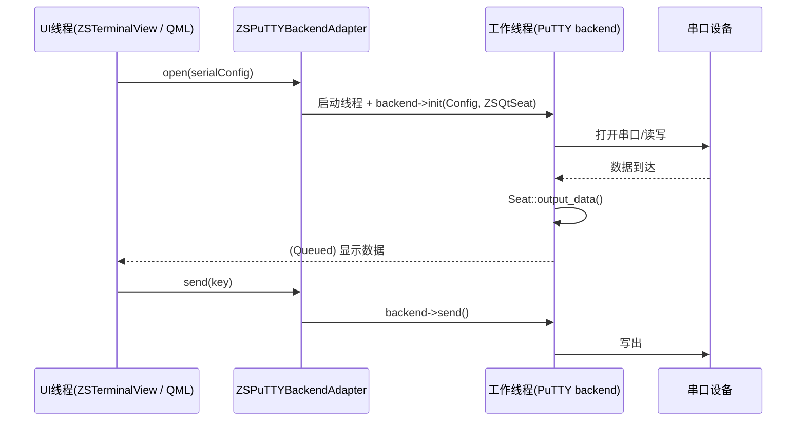

# ZosnTerm 软件架构需求文档

| 项 | 内容 |
|---|---|
| 项目名称 | ZosnTerm |
| 文档类型 | 软件架构需求文档（SARD） |
| 版本 | v0.2（更新：QML UI / PuTTY 0.85 / ZS 命名前缀） |
| 日期 | 2026-11-06 |
| 作者 | Nick |
| 状态 | 待评审 |
| 定位 | 个人使用的多协议终端工具（对标 XShell / WindTerm / MobaXterm），阶段一聚焦**串口** |

---

## 0. 结论先行：关键架构决策

| # | 决策点 | 选定方案 | 理由（一句话） |
|---|---|---|---|
| D1 | 技术栈 | **Qt 6 (C++) + QML（Qt Quick）** | 与现有 HMI 技术栈（QML）一致；终端视图用 C++ `QQuickItem` 暴露给 QML，外壳用 QML，引擎层不变 |
| D2 | 串口引擎 | **内嵌 PuTTY 后端源码** | PuTTY 自带串口传输 + VT 终端仿真 + 跨平台（Win/Unix）实现，一次集成，SSH/Telnet 等后续协议近乎免费 |
| D3 | 许可 | **PuTTY 为 MIT 许可** | 内嵌无 copyleft 传染，个人/分发均自由，仅保留版权声明 |
| D4 | 平台 | **阶段一即跨平台（Windows + Linux）** | PuTTY 核心已原生支持两端串口，Qt 跨平台成本极低，避免后期重写 |
| D5 | UI 框架 | **QML（Qt Quick）** | 用户指定；外壳 QML 编写，终端视图为 C++ `QQuickPaintedItem` 注册到 QML，性能与可定制兼顾 |
| D6 | 构建系统 | **CMake** | 与 Qt 6 官方工具链一致，便于 vendoring PuTTY 与多平台构建 |
| D7 | 线程模型 | **每连接一个工作线程 + PuTTY 自有事件循环** | 隔离阻塞 IO 与 UI 线程，Seat 回调经信号槽回投主线程渲染 |
| D8 | 第三方版本 | **PuTTY 锁定 0.85（2026-08-16，最新稳定版）** | 固定 release tag，升级单列任务 |
| D9 | 命名规范 | **项目自有类型统一 `ZS` 前缀** | 类/接口/结构体/枚举一律 `ZS` 开头；PuTTY/Qt/标准库符号不前缀 |

> 本章为评审锚点：若对某条决策有异意，先改 D1–D9，再往下读其余章节。

---

## 1. 项目概述

### 1.1 背景与动机
日常工作涉及车载 HMI（IMX8/IMX6 Yocto + Windows）调试，需要通过串口连接设备、收发数据、抓日志。现有 XShell/WindTerm/MobaXterm 功能庞杂或授权受限，且不便按个人习惯定制。ZosnTerm 目标是做一个**轻量、可定制、跨平台**的个人终端，阶段一先把串口做扎实，后续平滑扩展到 SSH/SFTP/远程桌面等多协议。

### 1.2 阶段一目标（串口）
- 稳定的串口连接：可配置波特率、数据位、停止位、校验、流控。
- 类 XShell 的终端体验：VT100/xterm 仿真、多标签、复制粘贴、滚屏、搜索。
- 会话管理：保存/加载串口会话配置、最近连接历史、快速重连。
- 日志：可配置串口数据记录（带时间戳、十六进制/文本模式）。
- 跨平台：Windows 与 Linux 均可编译运行，行为一致。

### 1.3 范围

| 类别 | 阶段一包含 | 阶段一不包含（留接口/后续） |
|---|---|---|
| 协议 | 串口（Serial） | SSH / Telnet / Rlogin / Raw / SFTP / 远程桌面 |
| 平台 | Windows + Linux | macOS（架构允许，暂不验证） |
| 功能 | 连接、终端仿真、会话管理、日志 | 宏/脚本、多窗格分屏、端口转发、密钥代理 |
| 分发 | 本地构建自用 | 安装包/自动更新/授权 |

### 1.4 非目标
- 不做企业级多用户/集中管理。
- 阶段一不做加密存储的凭据库（未来 SSH 才需要）。
- 不重写 PuTTY 的传输/仿真逻辑，只做适配与外壳。

---

## 2. 术语与缩略语

| 术语 | 含义 |
|---|---|
| Backend | PuTTY 中的连接后端抽象（serial/ssh/telnet…），提供统一 `init/send/close` 接口 |
| Seat | PuTTY 的 UI 抽象层（vtable），前端实现它以接管输出、提示、窗口事件 |
| Ldisc | Line discipline，处理本地回显、特殊键（如 Ctrl-C） |
| TermWin / terminal.c | PuTTY 的 VT 终端仿真核心，维护屏幕缓冲与绘制回调 |
| uX11 / uxsel | PuTTY Unix 前端的事件循环/select 抽象 |
| Session | 一次连接的全部配置与运行时状态（UI 无关），本项目对应 `ZSSession` |
| Vendoring | 将第三方源码直接纳入本仓库一起编译 |
| QQuickPaintedItem | Qt Quick 中可用 QPainter 绘制的 C++ 项，本项目的终端视图基类 |

> 命名约定见 §12.4：本项目所有自有类型加 `ZS` 前缀；上表中 PuTTY 的 `Backend`/`Seat`/`Ldisc`/`terminal.c` 等为第三方符号，保持原名不前缀。

---

## 3. 总体架构

### 3.1 分层架构图

```mermaid
graph TD
    subgraph UI["UI 层 (Qt 6 QML / Qt Quick)"]
        MW[ZSMainWindow.qml 窗口/多标签]
        SM[ZSSessionManagerDlg.qml]
        SD[ZSSettingsDlg.qml]
        TV[ZSTerminalView C++ QQuickItem]
    end

    subgraph ABS["会话与终端抽象层 (C++)"]
        SESS[ZSSession / ZSSessionManager]
        ICONN[ZSIConnection 接口]
        ITERM[ZSITerminalView 接口]
    end

    subgraph ENG["连接引擎层 (C++)"]
        ADAPT[ZSPuTTYBackendAdapter]
        SEAT[ZSQtSeat 实现 Seat]
    end

    subgraph CORE["PuTTY Core (vendored 0.85, 静态库 libputty)"]
        BE[Backends: serial (+ssh/telnet 预留)]
        TERM[terminal.c 仿真]
        LDISC[ldisc.c]
        MISC[misc/network/timing 工具]
    end

    subgraph PLAT["平台抽象层 (C++)"]
        SENUM[ZSPlatformSerial / ZSPlatformPaths / 事件循环桥]
    end

    subgraph DATA["数据/持久化层 (C++)"]
        CFG[ZSConfigStore]
        LOG[ZSLogger]
    end

    MW --> SESS
    SM --> SESS
    SD --> CFG
    TV --> ITERM
    SESS --> ICONN
    ICONN --> ADAPT
    ADAPT --> SEAT
    ADAPT --> BE
    BE --> TERM
    BE --> LDISC
    TERM --> SEAT
    SEAT --> TV
    ADAPT --> PLAT
    SESS --> CFG
    LOG --> DATA
```

### 3.2 分层职责

| 层 | 职责 | 关键类型（本项目） |
|---|---|---|
| UI 层 | QML 写外壳（窗口/标签/菜单/对话框）；C++ `ZSTerminalView` 负责终端渲染与输入 | `ZSMainWindow.qml`, `ZSTerminalView`, `ZSSessionManagerDlg.qml` |
| 抽象层 | 把"连接"与"显示"从具体引擎解耦，使 UI 不感知 PuTTY | `ZSIConnection`, `ZSISession`, `ZSITerminalView` |
| 引擎层 | 适配 PuTTY 的 Backend/Seat，桥接 Qt 信号槽与线程 | `ZSPuTTYBackendAdapter`, `ZSQtSeat` |
| PuTTY Core | 串口传输、VT 仿真、行规、计时（vendored 0.85） | `serial.c`, `terminal.c`, `ldisc.c` |
| 平台抽象 | 串口设备枚举、配置/日志路径、事件循环接入 | `ZSPlatformSerial`, `ZSPlatformPaths` |
| 数据层 | 会话配置、历史、日志的读写与存储 | `ZSConfigStore`, `ZSSessionRepository`, `ZSLogger` |

### 3.3 模块依赖原则
- **单向依赖**：UI → 抽象层 → 引擎层 → PuTTY Core；数据层被抽象层/UI 引用。
- **引擎层是唯一允许 `include` PuTTY 头文件的层**；其余层只看到 `ZSIConnection` 抽象。
- 跨平台差异收敛在**平台抽象层**与**PuTTY 自带 `platform/`**，业务代码不写 `#ifdef`。
- QML 只通过注册的 C++ 类型/上下文属性与抽象层交互，不直接接触 PuTTY。

---

## 4. 连接引擎层（PuTTY 内嵌设计）—— 核心

### 4.1 PuTTY 源码中可复用的部分
PuTTY 采用"核心与前端分离"设计，核心部分与 GUI 无关，可直接 vendoring 编译为库（版本锁定 **0.85**）：

| 模块 | 文件 | 阶段一用途 |
|---|---|---|
| 串口后端 | `serial.c`（含 `serial_win32_init` / `serial_unix_init`） | 跨平台串口传输 |
| 终端仿真 | `terminal.c` | VT100/xterm 仿真、屏幕缓冲、绘制回调 |
| 行规 | `ldisc.c` | 本地回显、特殊键处理 |
| 配置结构 | `settings.c` / `config.c` | PuTTY `Config` 结构体承载串口参数 |
| 计时/网络 | `timing.c` / `network.c` | 后端需要的定时器与 socket 抽象 |
| 工具 | `misc.c`, `tree234.c`, `sshkeys.c`（未来） | 通用数据结构 |
| 前端抽象 | `putty.h` 中 `Seat` / `Backend` / `LogContext` vtable | 我们实现 `Seat` 接入 Qt |

> 关键点：PuTTY 的 `Backend` 对 serial/ssh/telnet 是**同一套接口**。阶段一仅启用 `serial` 后端，阶段二启用 `ssh` 几乎只改"选哪个 backend"，引擎层无需重写。

### 4.2 内嵌与构建方式
- 将 **PuTTY 0.85**（`putty-0.85.tar.gz`，2026-08-16）的**核心源码** vendoring 到 `src/3rdparty/putty/`，锁定该 tag，不随网络漂移。
- 用 CMake 将其编译为**静态库 `libputty`**（仅含核心，不含 `windows/`/`unix/` GUI 前端）。
- 在 `libputty` 之上，我们提供自己的"轻量前端"：实现 `Seat`（`ZSQtSeat`）、提供 `uX11` 风格的 select 循环（见 4.4），替换 PuTTY 自带 GUI 前端。
- **许可**：PuTTY 为 MIT。在仓库 `3rdparty/putty/LICENSE` 保留原始声明，并在项目 NOTICE 中致谢。

### 4.3 Seat / Backend 适配桥（`ZSPuTTYBackendAdapter` + `ZSQtSeat`）
PuTTY 通过 `Seat` vtable 回调前端。我们需要在 `ZSQtSeat` 中实现的关键回调：

| PuTTY Seat 回调 | Qt 侧实现 | 说明 |
|---|---|---|
| `output_data(buf, len)` | 投递到 `ZSTerminalView` 的接收队列 | 远端/串口来的数据显示 |
| `echoedit_update` / `get_userpass_input` | （串口阶段少用到） | 为未来 SSH 用户名/密码提示预留 |
| `set_titles` | 更新 QML 标签标题 | 连接名/状态 |
| `update_specials_menu` | 更新右键菜单 | 特殊命令（未来） |
| `seat_verbose` / `seat_invalidate` | 重绘请求 | 触发 `ZSTerminalView` 重绘 |
| `clipboards` | 复制/粘贴桥接 | 与系统剪贴板互通 |

`ZSPuTTYBackendAdapter` 负责：
1. 把 `ZSIConnection` 的 `open(config)` 翻译成 PuTTY `Config` 并 `backend->init(...)`。
2. 持有后端实例与 `ZSQtSeat` 实现，转发 `send()` / `close()`。
3. 通过 **QueuedConnection** 把 `Seat` 回调（发生在工作线程）安全地回投到 UI 线程渲染。

### 4.4 线程与事件循环模型
- **每连接一个 `QThread`**：`ZSPuTTYBackendAdapter` 在该线程内运行 PuTTY 后端。
- PuTTY 后端依赖一个 select/poll 循环与定时器。复用 PuTTY 的 `timing.c` 机制，在 `QThread` 中用一个 `QTimer` 周期性驱动 `run_timers()`，并用 `QSocketNotifier`/自管 fd 集驱动 IO 就绪（即 PuTTY 的 `uX11`/`uxsel` 语义在 Qt 下的等价物）。
- **数据流向**：串口/远端 → PuTTY backend → `Seat::output_data` →（QueuedConnection）→ UI 线程 → `ZSTerminalView` 渲染。
- **输入流向**：键盘 → `ZSTerminalView`（QML 内）→ `ZSIConnection::send` → `backend->send` → 串口。
- UI 线程永不阻塞在 IO；后端线程不直接触碰 Qt 控件（仅通过信号槽）。



### 4.5 串口配置映射
PuTTY `Config` 字段与 UI 控件的映射（阶段一核心参数）：

| UI 参数 | PuTTY Config 字段 | 备注 |
|---|---|---|
| 串口号（COM3 / /dev/ttyUSB0） | `serline` | 由平台枚举填充（`ZSSerialPortInfo`） |
| 波特率 | `serspeed` | 110–921600，含自定义 |
| 数据位 | `serdatabits` | 5/6/7/8 |
| 停止位 | `serstopbits` | 1/1.5/2 |
| 校验 | `serparity` | None/Odd/Even/Mark/Space |
| 流控 | `serflow` | None/XONXOFF/RTSCTS/DSRDPR |
| 本地回显 | `localecho` | 调试常用 |
| 本地行编辑 | `localedit` | 配合 ldisc |

> 平台枚举：Windows 用 `QSerialPortInfo::availablePorts()` 或 `SetupDi*`；Linux 用 `/dev/ttyUSB*`/`ttyACM*` + `udev`。枚举结果经平台抽象层统一为 `ZSSerialPortInfo` 列表。

---

## 5. 终端仿真与渲染（QML 方案）

### 5.1 仿真核心
直接使用 PuTTY `terminal.c` 作为仿真核心（已支持 VT100/VT220/xterm/UTF-8），由 `Seat::output_data` 喂入，`terminal.c` 维护屏幕行缓冲与光标/属性（颜色、粗体、下划线）。

### 5.2 渲染方案（`ZSTerminalView`，C++ → QML）
- `ZSTerminalView` 继承 **`QQuickPaintedItem`**（阶段一），通过 `qmlRegisterType<ZSTerminalView>("ZosnTerm", 1, 0, "ZSTerminalView")` 注册到 QML，作为 `<ZSTerminalView>` 元素在 QML 布局中放置（每标签一个实例）。
- 在 `paint(QPainter*)` 中，依据 PuTTY 的绘制回调把字符单元（glyph + 前景/背景色 + 属性）绘制到项表面。
- 不依赖第三方终端控件（如 QTermWidget），因为仿真已由 PuTTY 负责，避免两套仿真逻辑冲突。
- **性能演进**：阶段一用 `QQuickPaintedItem`（实现简单）；高频输出场景可后续升级为自定义 `QQuickItem` + 场景图（QSG）节点批量绘制。
- 支持：等宽字体、DPI 缩放、滚轮滚屏、选择高亮、右键菜单（右键菜单由 QML 提供，动作回调到 C++）。

### 5.3 输入/输出管线
- 输出：见 4.4 数据流向；带可选**日志分流**（见 8.2）。
- 输入：QML 键盘事件 → `ZSTerminalView` 捕获 → 按 `localedit` 决定是否本地回显 → `ZSIConnection::send`。
- 二进制/十六进制视图：提供可切换的显示模式（文本 / Hex），便于车载协议调试。

---

## 6. UI / 会话架构（QML 外壳）

### 6.1 窗口与多标签
- `ZSMainWindow.qml`：`Window` + `TabBar`/`SwipeView` 承载多个 `ZSTerminalView`，每标签 = 一个 `ZSIConnection` + `ZSTerminalView`。
- C++ 侧以上下文属性/单例暴露 `ZSSessionManager`、`ZSSession` 模型给 QML；标签的增删、状态由 QML 驱动，底层连接由 C++ 引擎执行。
- 右键标签：重命名、断开、克隆、关闭。
- 顶部工具栏（QML）：新建串口、快速连接、设置、日志开关。

### 6.2 会话管理器
- `ZSSessionManagerDlg.qml`：树形/列表展示已保存会话，支持新建、编辑、删除、双击连接；绑定到 C++ `ZSSessionManager`（`QAbstractListModel` 派生）。
- `ZSSession` 对象含：名称、协议类型（阶段一仅 serial）、连接参数、外观（字体/配色）、日志设置。
- `ZSSessionManager` 负责生命周期与持久化（委托 `ZSConfigStore`）。

### 6.3 配置与设置
- `ZSSettingsDlg.qml`：全局设置通过 `ZSConfigStore` 读写。
- 全局设置：默认字体、配色方案、滚动缓冲行数、编码（UTF-8/GBK，车载设备常遇 GBK）。
- 串口专用：默认波特率、常用参数模板（如"车载调试 115200 8N1"）。
- 设置采用"全局 + 每会话覆盖"的继承模型。

---

## 7. 跨平台设计

### 7.1 平台抽象边界
所有 `#ifdef _WIN32` / `__linux__` 收敛在两处：
1. **PuTTY Core 自带的 `platform/`**（处理底层 IO、计时、线程原语）—— 我们基本不碰。
2. **本项目 `platform/` 层（C++）**：`ZSPlatformSerial`、`ZSPlatformPaths`、事件循环桥；QML 不感知平台差异。

### 7.2 Windows vs Linux 差异点

| 差异点 | Windows | Linux |
|---|---|---|
| 串口路径 | `COM3`, `COM10` | `/dev/ttyUSB0`, `/dev/ttyACM0` |
| 枚举 | `QSerialPortInfo` / `SetupDi` | `udev` / `sysfs` |
| 权限 | 即插即用，无需权限 | 常需 `dialout` 组或 `sudo`（文档提示） |
| 事件循环接入 | 复用 PuTTY `win*` 语义经 Qt 桥接 | 复用 `uX11` select 语义经 Qt 桥接 |
| 配置文件位置 | `%APPDATA%/ZosnTerm` | `~/.config/ZosnTerm` |

### 7.3 构建系统
- 根 `CMakeLists.txt`：配置 Qt6（含 Quick/Qml）+ `libputty` 子项目 + 本项目的 `src/` + QML 资源（`.qrc` 或 `qt_add_qml_module`）。
- `libputty` 作为 CMake 子目录/接口库编译进可执行文件（静态链接）。
- 依赖获取：Qt 6 用官方 `qt-cmake`；PuTTY 0.85 走 **vendoring**（锁定版本，不拉网络）。
- 产物：Windows `.exe`、Linux 可执行文件；阶段一不做安装包。

---

## 8. 数据模型与持久化

### 8.1 会话配置模型（草案）
```json
{
  "sessions": [
    {
      "id": "uuid",
      "name": "车载调试-ECU",
      "protocol": "serial",
      "serial": {
        "port": "COM3",
        "baud": 115200,
        "dataBits": 8,
        "stopBits": 1,
        "parity": "none",
        "flow": "none",
        "localEcho": false,
        "localEdit": false
      },
      "display": { "font": "Consolas", "fontSize": 12, "scheme": "dark" },
      "log": { "enabled": true, "path": "...", "mode": "text", "timestamp": true }
    }
  ]
}
```

### 8.2 历史与日志
- **连接历史**：最近 N 条连接（端口/参数/时间），供快速重连。
- **串口日志**：可开关，输出到文件；模式支持"纯文本 + 时间戳""十六进制转储""同时记录收发方向"。日志写入在引擎层（`ZSPuTTYBackendAdapter`）旁路分流，不阻塞渲染。
- 编码：日志文件默认 UTF-8，可选 GBK（车载设备常见）。

### 8.3 存储位置
- Windows：`%APPDATA%/ZosnTerm/`（配置、日志、历史）。
- Linux：`~/.config/ZosnTerm/`、`~/.local/share/ZosnTerm/`。
- 由 `ZSPlatformPaths` 统一解析，业务层不感知绝对路径。

---

## 9. 非功能需求

| 类别 | 需求 | 目标/说明 |
|---|---|---|
| 性能 | 大数据量串口吞吐不卡 UI | 渲染与 IO 线程分离；滚动缓冲上限可配（默认 10000 行） |
| 稳定性 | 串口意外断开不崩溃 | backend 异常经 Seat 上报，UI 显示"已断开"并可重连 |
| 健壮性 | 错误参数/非法端口优雅处理 | 打开失败给出明确提示，不 assert |
| 可维护 | 引擎层是唯一耦合 PuTTY 处 | 升级 PuTTY 版本只动 `libputty` + 适配桥 |
| 可扩展 | 新协议 = 新 Backend 接入 | `ZSIConnection` 不变，阶段二 SSH 仅加 `ZSSshBackendAdapter` |
| 安全（未来） | SSH 私钥本地加密存储 | 阶段一不涉及；架构预留 `ZSCredentialStore` |
| 许可 | 保留 PuTTY MIT 声明 | NOTICE 文件致谢，不修改 PuTTY 许可 |
| 易用 | 常用参数模板、快速连接 | 降低每次手填成本 |

---

## 10. 阶段规划与里程碑

### 阶段一：串口（本期）
| 里程碑 | 交付物 | 退出标准 |
|---|---|---|
| M1 脚手架 | Qt6 + QML + CMake + vendored libputty(0.85) 可编译 | QML 窗口启动，链接通过 |
| M2 引擎适配 | `ZSPuTTYBackendAdapter` + `ZSQtSeat`，单连接通串口 | 能打开 COM/tty，收发回显正确 |
| M3 终端视图 | `ZSTerminalView`（QQuickPaintedItem）渲染 PuTTY 仿真 | 中文/颜色/滚屏正常 |
| M4 会话管理 | `ZSSessionManager` 保存/加载/历史/快速连接 | 双击会话可重连 |
| M5 日志与配置 | 日志分流、`ZSSettingsDlg` 全局/会话设置 | 日志文件正确、设置持久化 |
| M6 跨平台验证 | Win + Linux 各编译运行 | 两端行为一致 |

### 阶段二及以后（路线图，仅架构预留）
- **SSH / Telnet / Rlogin**：启用 PuTTY 已有 backend，新增对应 `ZS*BackendAdapter`，QML 增加主机/端口/认证面板。
- **SFTP / 文件管理**：复用 PuTTY `psftp` 核心或独立 SFTP 会话面板。
- **远程桌面 / 串口 over 网络**：未来扩展点。
- **分屏 / 宏脚本 / 端口转发**：在 `ZSIConnection` 与 `ZSSession` 之上叠加。

> 架构上以上均不需要改动抽象层接口，仅新增"协议适配器 + QML 面板"，这是内嵌 PuTTY 的最大收益。

---

## 11. 风险与开放问题

| 风险/问题 | 说明 | 缓解 |
|---|---|---|
| PuTTY 与 Qt 事件循环集成复杂度 | Backend 依赖 select/timer，需稳定桥接到 Qt | M2 先单线程验证，再切工作线程 |
| PuTTY 版本升级 | vendoring 版本升级可能改 vtable/接口 | 锁定 **0.85** tag，升级单列任务（D8） |
| QML 终端渲染性能 | 高频输出需高效绘制 | 阶段一 `QQuickPaintedItem`；必要时升级 QSG 场景图 |
| Linux 串口权限 | 用户需加入 `dialout` | 文档提示 + 首次运行自检 |
| 中文编码 | 设备常发 GBK | 连接级编码可配，默认 UTF-8 |
| QML 与 C++ 绑定面 | 信号/属性/上下文属性需规范 | 抽象层 `ZS*` 类型统一注册，QML 只依赖注册接口 |

---

## 12. 附录

### 12.1 建议目录结构
```
ZosnTerm/
  CMakeLists.txt
  src/
    app/            # main.cpp, ZSApplication
    qml/            # ZSMainWindow.qml, ZSSessionManagerDlg.qml, ZSSettingsDlg.qml, 通用组件
    terminal/       # ZSTerminalView (QQuickPaintedItem 渲染与输入)
    session/        # ZSSession, ZSSessionManager, ZSIConnection, ZSISession
    engine/         # ZSPuTTYBackendAdapter, ZSQtSeat, (未来 ZSSshBackendAdapter)
    platform/       # ZSPlatformSerial, ZSPlatformPaths, 事件循环桥
    data/           # ZSConfigStore, ZSSessionRepository, ZSLogger
    3rdparty/putty/ # vendored PuTTY 0.85 核心源码 (libputty)
  cmake/
  tests/
  docs/             # 本文档
  NOTICE            # 第三方许可致谢 (PuTTY MIT)
```

### 12.2 第三方依赖清单
| 依赖 | 版本策略 | 许可 | 用途 |
|---|---|---|---|
| Qt 6 | 系统/官方安装（含 Quick/Qml） | LGPL | UI(QML)、事件循环、串口枚举 |
| PuTTY Core | vendoring，**锁定 0.85**（2026-08-16） | MIT | 串口/仿真/未来多协议引擎 |
| （可选）Catch2 / GoogleTest | 包管理 | BSD | 单元测试 |

### 12.3 参考资料
- PuTTY 最新稳定版 0.85：https://www.chiark.greenend.org.uk/~sgtatham/putty/latest.html
- PuTTY 源码与许可：https://www.chiark.greenend.org.uk/~sgtatham/putty/
- Qt 6 QML 文档：https://doc.qt.io/qt-6/qtqml-index.html
- PuTTY `Seat`/`Backend` 接口定义：`putty.h`

### 12.4 命名规范（D9）
- **前缀**：项目自有类型（类、接口、结构体、枚举）统一以 `ZS` 开头，驼峰式。例：`ZSSession`、`ZSIConnection`、`ZSQtSeat`、`ZSSerialPortInfo`、`ZSCredentialStore`。
- **不前缀**：PuTTY vendored 源码（`Seat`/`Backend`/`terminal.c`/`Config`…）、Qt 类型（`QQuickPaintedItem`/`QThread`…）、标准库符号，保持原名。
- **QML 文件**：与 C++ 类同名对应，如 `ZSMainWindow.qml` 对应窗口（`ZSApplication` 在 C++ 中加载）。QML 内部组件可小写开头的 id，但类型名与 C++ 注册名一致（`ZSTerminalView`）。
- **命名空间**：可选包裹 `ZosnTerm` 命名空间；类名 `ZS` 前缀已足以区分第三方，本文档示例以类前缀为准。

---

> 文档状态：草案 v0.2（已纳入 QML UI / PuTTY 0.85 / ZS 命名前缀）。下一步建议评审 D1–D9 与第 4 章引擎设计，确认后进入 M1 脚手架实现。
